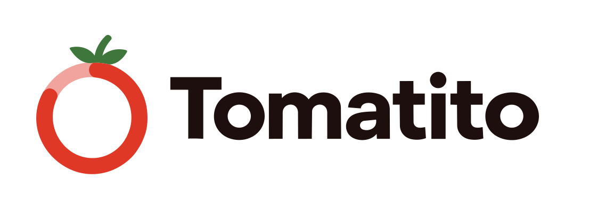
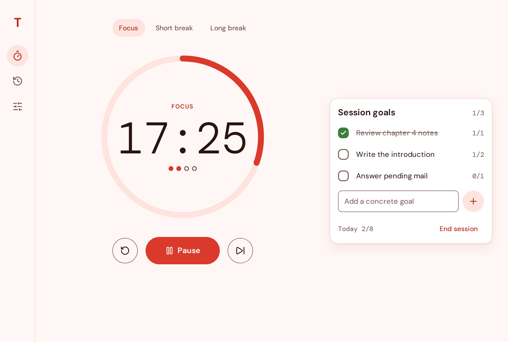
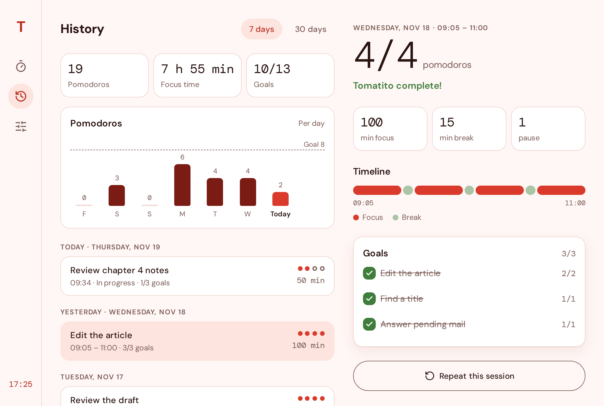

<h1 align="center">
  <picture>
    <source media="(prefers-color-scheme: dark)" srcset="docs/logo-dark.svg" />
    
  </picture>
</h1>

<p align="center">
  A minimalist Pomodoro timer for desktop and web, in English and Spanish.
</p>

<p align="center">
  <picture>
    <source media="(prefers-color-scheme: dark)" srcset="docs/screenshots/timer-dark.png" />
    
  </picture>
  <picture>
    <source media="(prefers-color-scheme: dark)" srcset="docs/screenshots/history-dark.png" />
    
  </picture>
</p>

## Features

- **Focus, short break and long break**, with your own lengths or one of three presets (25/5, 50/10, 15/3).
- **Session goals:** write down what you want to get done, estimate it in pomodoros, and each one you finish is credited to the next goal.
- **History:** pomodoros, focus time and goals of the last 7 or 30 days, with the timeline of each session. Any session can be repeated.
- **Daily goal** shown next to your goals and in the chart.
- **Sound and notifications** when a phase ends, and the option to start the next one automatically.
- **Light and dark**, following the system.
- **English and Spanish**, following the system or chosen in Settings.

Only on desktop:

- **Tray icon:** the timer keeps going when you close the window, and you can control it from the tray.
- **Floating window** that keeps the time in view while you use other apps. You can drag it and dock it to a screen edge.
- **Global shortcut** to start or pause from anywhere.

## Your data

Everything stays on your device. There are no accounts, no sync and no tracking.

The desktop app and the web app each keep their own data. On the web it lives in your browser, so clearing the site's data deletes it.

## Platforms

Tomatito is young, and it has mostly been used on one system:

| Platform | Status |
| --- | --- |
| Linux, X11 | Developed and tested on KDE Plasma |
| Linux, Wayland | Not tested; the floating window and the global shortcut are disabled |
| Windows, macOS | Not tested yet |
| Web | Tested in Chromium |

If you try it somewhere else, [tell us how it went](https://github.com/saitamaHero/tomatito/issues). Mobile is not planned for now; the minimum window width is 480 px.

## Run it

There are no installers yet, so you run it from the source code. You need [Node.js](https://nodejs.org) (22.12 or later 22.x, or 24) and [pnpm](https://pnpm.io/installation) 11. The desktop app also needs [Rust](https://rustup.rs) 1.90 or later and the [system packages for Tauri](CONTRIBUTING.md#setup).

```bash
git clone https://github.com/saitamaHero/tomatito.git
cd tomatito
pnpm install
```

| To get | Run |
| --- | --- |
| The web app, at http://localhost:1420 | `pnpm dev` |
| The desktop app | `pnpm tauri dev` |
| A production web build, in `dist/` | `pnpm build` |
| A desktop installer for your system | `pnpm tauri build` |

## Keyboard shortcuts

| Key | What it does |
| --- | --- |
| <kbd>Space</kbd> | Start, pause or resume |
| <kbd>S</kbd> | Finish the pomodoro or skip the break |
| <kbd>R</kbd> | Reset the current phase |
| <kbd>N</kbd> | Write a new goal |
| <kbd>Ctrl</kbd>/<kbd>Cmd</kbd> + <kbd>Alt</kbd> + <kbd>Shift</kbd> + <kbd>T</kbd> | Start or pause from any app (desktop) |

## Contributing

Bug reports, ideas, translations and code are welcome, in English or Spanish. [CONTRIBUTING.md](CONTRIBUTING.md) explains how to set up the project and what a pull request needs. Everyone taking part is expected to follow the [code of conduct](CODE_OF_CONDUCT.md).

To report a security problem, follow [SECURITY.md](SECURITY.md) instead of opening a public issue.

## Support

Tomatito is free. If it helps you focus, you can support it by buying me a coffee:

<a href="https://buymeacoffee.com/dionicio.acevedo">
  
</a>

## Built with

[Tauri 2](https://tauri.app), [Vue 3](https://vuejs.org), TypeScript, Vite and Rust. The fonts are [DM Sans](https://fonts.google.com/specimen/DM+Sans) and [DM Mono](https://fonts.google.com/specimen/DM+Mono) (SIL Open Font License), and the icons are from [Lucide](https://lucide.dev) (ISC).

## License

[MIT](LICENSE)
